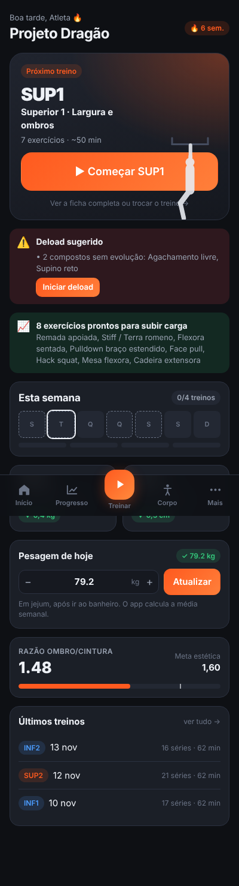
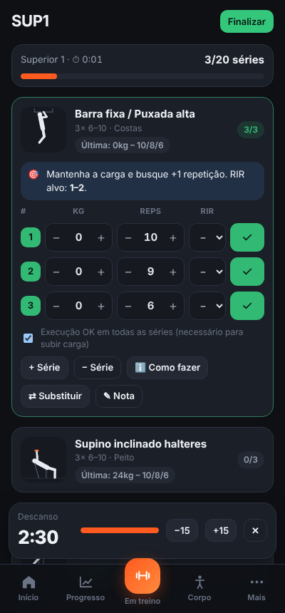
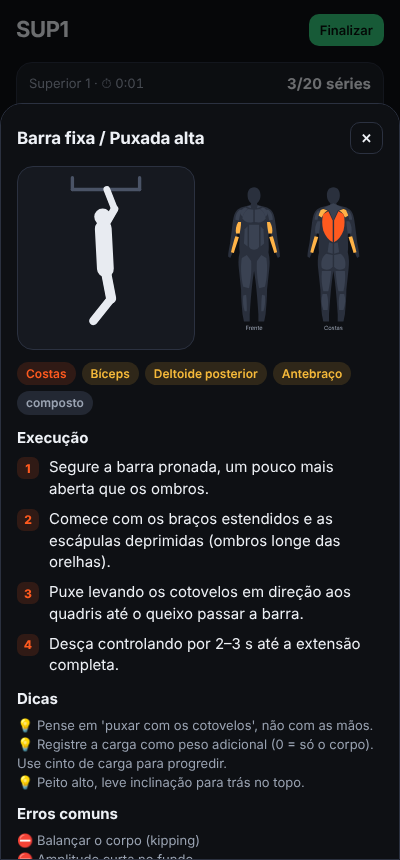
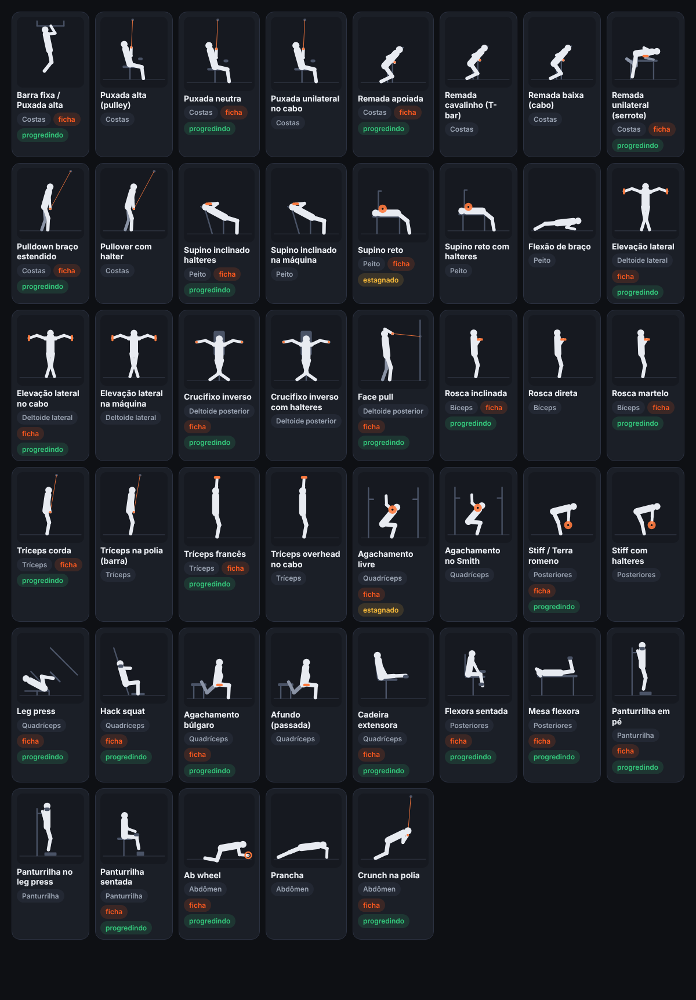

# Projeto Dragão 🐉

App de treino de hipertrofia natural focado em **V-taper** (ombros e dorsais largos, cintura fina).
PWA mobile-first, funciona offline e guarda tudo no próprio aparelho.

## Funcionalidades

- **Ficha SUP1 → INF1 → SUP2 → INF2** em rotação: o app sempre mostra o próximo treino da fila.
- **Sessão de treino**: carga e reps pré-preenchidas pela **progressão dupla**, último desempenho ao lado,
  RIR opcional, execução OK por série, timer de descanso automático (com som e vibração), aquecimento sugerido,
  substituição de exercícios e notas.
- **Resumo pós-treino** com recordes pessoais (carga, e1RM, reps) e o que sobe de carga na próxima vez.
- **Biblioteca de 45 exercícios** com **ilustrações animadas**, mapa muscular (frente/costas), passo a passo,
  dicas e erros comuns.
- **Histórico por exercício**: gráficos de e1RM (Epley), carga, volume e reps; status `progredindo / estagnado / regredindo`.
- **Volume semanal por músculo** × referência calculada da sua ficha (ajusta para 3 ou 4 treinos/semana).
- **Detecção de deload** (compostos travados, fadiga/sono ruins por 2 semanas, 10 semanas sem deload) e semana de deload automática
  (metade das séries, mesma carga, 3–4 RIR).
- **Corpo e medidas**: pesagem diária com média semanal, check-in semanal (cintura, sono, fadiga, motivação, dor),
  avaliação mensal com 6 medidas, **fotos** frente/lado/costas (comparação antes × agora), razão ombro/cintura, top 5 evoluções
  e sugestão de decisão de volume que você confirma.
- **Nutrição**: Mifflin-St Jeor, metas de kcal e macros por modo (cutting leve, recomposição, ganho lento) e ajuste quinzenal
  pela tendência do peso (no modo cintura, a cintura pesa mais).
- **Ferramentas**: calculadora de anilhas, 1RM estimado com tabela de cargas, aquecimento.
- **Configurações**: perfil, passos de carga por equipamento, anilhas, editor da ficha, tema claro/escuro,
  lembretes, backup JSON (com fotos) e exportação CSV.

## Rodando

```bash
npm install
npm run dev       # desenvolvimento
npm test          # regras do app (progressão, deload, volume, nutrição) e critérios de aceite
npm run build     # gera dist/ (PWA instalável)
```

## Estrutura

```
src/
  data/        exercícios e programa padrão
  logic/       progressão, análise (estagnação/deload/volume), nutrição, datas, notificações
  store/       estado persistido (localStorage) e fotos (IndexedDB)
  components/  ilustrações animadas, mapa muscular, gráficos, timer, UI
  pages/       telas
```

A especificação original está em `docs/projeto-dragao-app-spec.md`.

## Telas

| Início | Sessão | Exercício |
|---|---|---|
|  |  |  |


